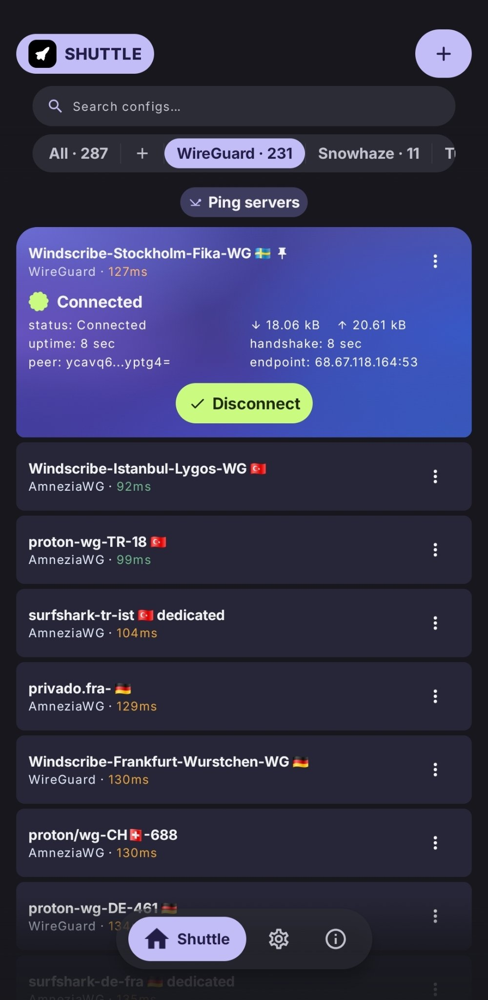
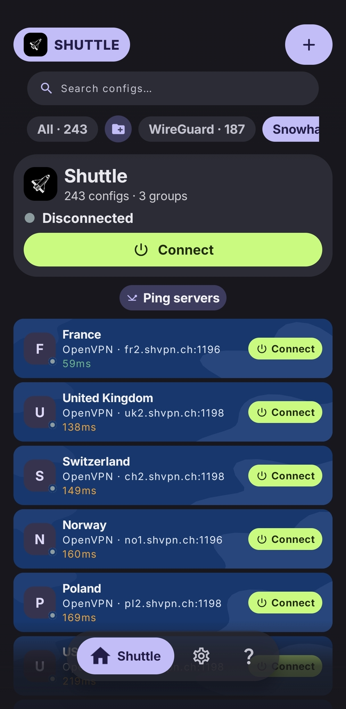
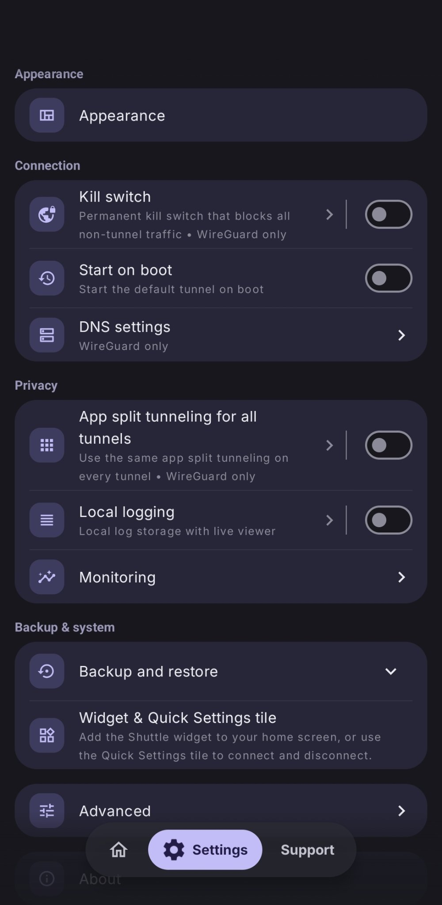

# Shuttle

A lightweight Android VPN client for OpenVPN, WireGuard and AmneziaWG.

## Features

- **OpenVPN** — import `.ovpn` files individually or from ZIP archives; save authentication credentials
- **WireGuard & AmneziaWG** — configure Amnezia-specific parameters, including QUIC/DNS/SIP mimic options and junk packets
- **Kill switch** and automatic tunnel behavior
- **Tunnel groups** — organize configurations with custom group names and ordering
- **Ping & sorting** — test server latency and sort configurations by ping
- **Per-app VPN** — select which apps use the VPN tunnel
- **Android integrations** — Quick Settings tiles and a home-screen widget
- **Backup & export** — export configurations as ZIP archives and edit configurations in the app
- **Connection logs** for troubleshooting
- **Appearance** — light, dark and system themes; English and Persian languages
- **APK variants** — universal, arm64-v8a (64-bit ARM) and armeabi-v7a (32-bit ARM)

## Download

Download APKs from [GitHub Releases](https://github.com/meishah/shuttle/releases). The project provides three ABI variants:

| Variant | Intended devices |
|---|---|
| `universal` | Android devices using the supported ARM architectures |
| `arm64-v8a` | 64-bit ARM devices |
| `armeabi-v7a` | 32-bit ARM devices |

## Screenshots

### Home — connected


### Home — disconnected


### Settings


## Usage

1. Install the APK and import VPN configurations using **+ → Import** (a single file or ZIP archive).
2. Use **Ping servers** to check latency, then select a configuration and tap **Connect**.
3. Long-press a configuration to rename, delete, move it to a group or edit it.
4. Long-press a group chip to change the group order.

## Build from source

```bash
./gradlew :app:assembleStandaloneRelease
```

Requires JDK 21 and Android SDK Platform 37 (extension level 2).

## Credits & licensing

Shuttle includes and builds upon open-source projects, including [WG Tunnel](https://github.com/wgtunnel/android) and [ics-openvpn](https://github.com/schwabe/ics-openvpn). Their original copyright notices and license terms must be retained. The repository's root [LICENSE](LICENSE) currently contains the MIT License notice from the upstream Shuttle/WG Tunnel code. The ics-openvpn component is licensed under GPLv3; see its accompanying license notices and the in-app open-source licenses screen for third-party license information.

**Important:** The repository currently contains code and dependencies under more than one license. Do not assume that every file in this repository is covered by the root MIT notice; check the relevant component's license before redistributing or modifying it.